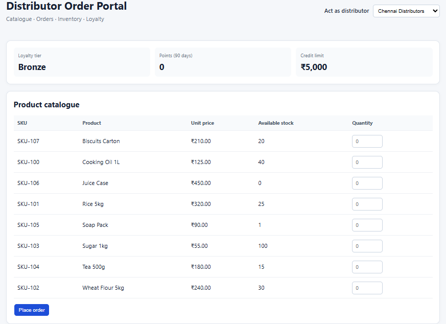
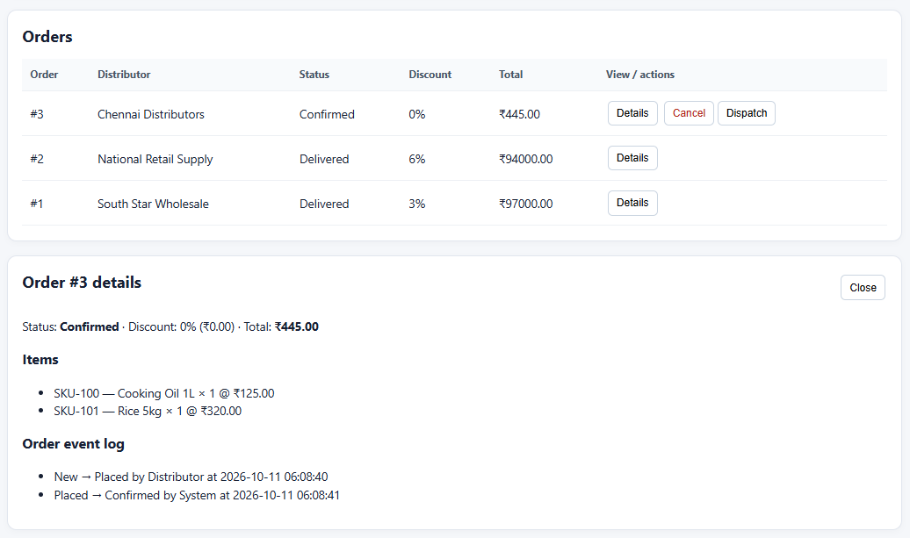
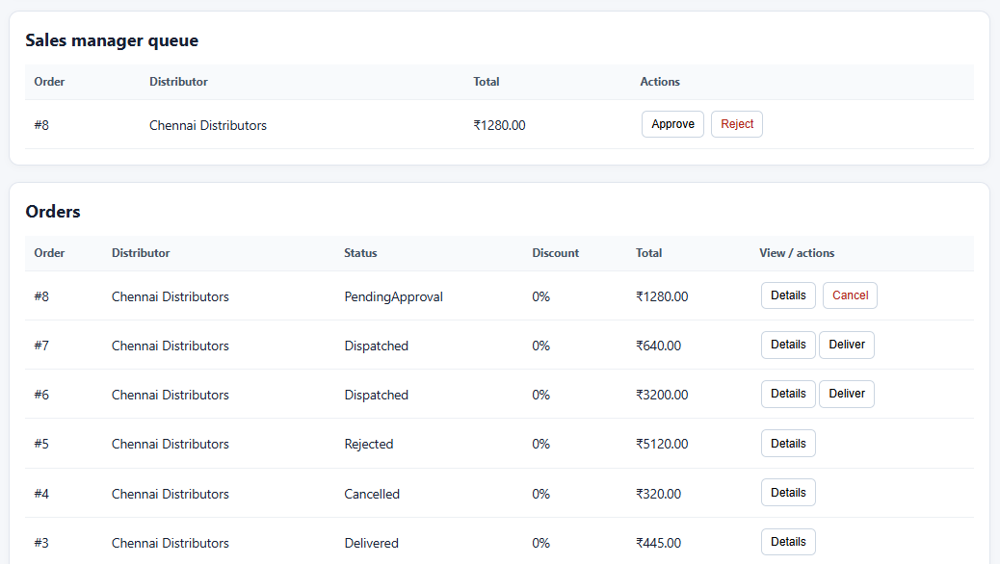

# Distributor Order Portal — Pitch Deck

## Slide 1 — The problem

Distributors need a clear view of product availability before placing orders. When stock, order status, credit approvals, and loyalty details are handled separately, it takes more time for distributors and sales teams to follow up.

## Slide 2 — Browse products and place an order

## Slide 3 — Track orders

## Slide 4 — Review approvals and loyalty

## Slide 5 — What is needed before launch

- **Integration:** Connect the portal to the company's real ERP system and test successful updates, failures, and retries.
- **Data migration:** Import product details, stock levels, distributor records, credit limits, and loyalty balances. Reconcile the imported data before launch.
- **Rollout:** Test key order and approval scenarios, train a small pilot group, monitor issues, then roll out to more distributors.
- **Access and support:** Add secure sign-in and role-based access, plus monitoring and a support process.

## Slide 6 — Possible next steps

- Add secure login and permissions for distributors and sales managers.
- Improve ERP delivery with reliable background retries and monitoring.
- Add automated tests for stock, credit, order status, and loyalty rules.
- Add clearer reports for order volume, fulfilment, and distributor activity.
